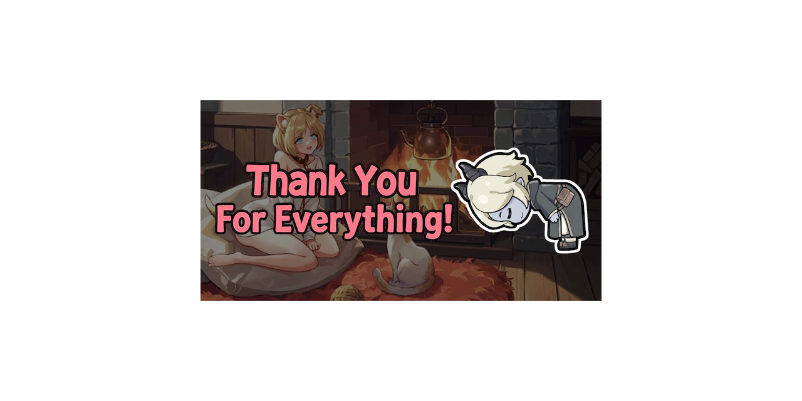

  

# NCs Guild Files
Everything I made to help the Guild. There's a lot of stuff!

## Files
- ISL Image Assets: 7 parts. Contains everything image-wise I made: Emojis, Stickers, Backgrounds, and more.
- ISL Tools: 4 parts. Contains the "tools" I've made, such as spreadsheets and simulators. Lotta unfinished stuff. Shame.
- ISL Text Files: 1 part. The most important one, contains the **ACTUAL** stuff I've used to run the Guild. Recruiting, Guides, and README. Please read... the "read" "me".

## How?
Because of the total file size, I had to split certain things into multiple parts. 

- You can open the ``.zip.001`` files to browse and open individual files (requires password).
- You can also extract the archives normally, as long as **all parts are in the same folder**. Start with the ``.001`` file.

## What program?
WinRar should work! If not, please use 7-Zip -- apologies for the inconvenience.

## What is the password?
It should be pretty obvious! There's a .txt file around here, whose title is a hint.

Or here: [Obvious hint](Password%20is%20guild%20name%20lowercase%20\(NCs\).txt)