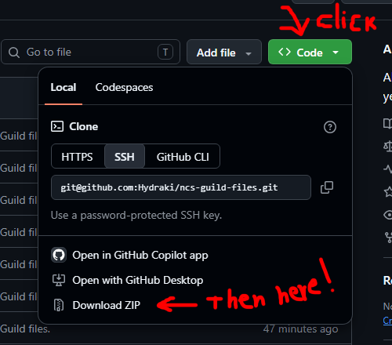

  

# NCs Guild Files
Everything I made over the years to help the Guild. There's a lot of stuff!

## How to Download?
Click the ~~Murky Olive~~ ~~Muted Mustard~~ Green-colored button that says "<> Code". Then click "Download Zip"!

  

## What are the Files?
- ISL Image Assets: 7 parts. Contains everything image-wise I made -- Emojis, Stickers, Backgrounds, and more.
- ISL Tools: 4 parts. Contains the "tools" I've made, such as spreadsheets and simulators. Lotta unfinished stuff. What a shame.
- ISL Text Files: 1 part. The most important one, as it contains the **ACTUAL** files I've used to run the Guild. Recruiting, Guides, and README. Please make sure to read... the "read" "me".

## How To Read?
Because of the total file size, I had to split certain things into multiple parts. 

- You can open the ``.zip.001`` files to browse and open individual files (requires password each time).
- You can also extract the archives normally, as long as **all parts are in the same folder**. Start with the ``.001`` file.

## What program to Use?
WinRar should work. If not, please use 7-Zip. Apologies for the inconvenience.

## What is the password?
It should be pretty obvious -- check the files. There's a .txt file whose title is a hint.

Or... just click here: [link to file](Password%20is%20guild%20name%20lowercase%20\(NCs\).txt)